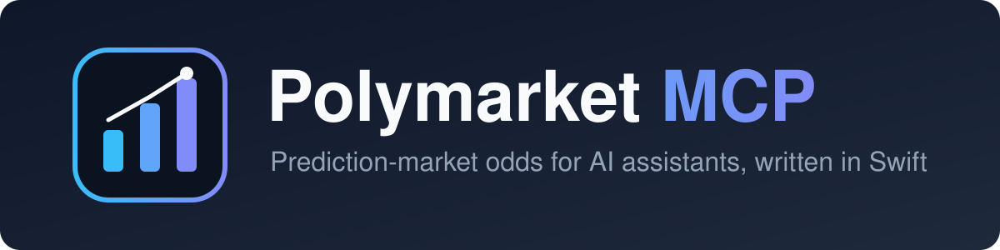

<p align="center">
  
</p>

# Polymarket MCP

A small, dependency-free [Model Context Protocol](https://modelcontextprotocol.io) server that gives AI assistants read-only access to [Polymarket](https://polymarket.com) prediction markets: search markets, check implied odds, inspect order books and look at price history.

Written in Swift 6 and split into a reusable client library, a CLI and the MCP server.

## Features

- Read-only: no wallet, no API key, no trading
- Talks to Polymarket's public Gamma (market data) and CLOB (order book, prices) APIs
- MCP server over stdio (newline-delimited JSON-RPC 2.0), no third-party dependencies
- Reusable `PolymarketAdapter` library for macOS 13+ and iOS 16+

## MCP tools

| Tool | Description | Arguments |
|---|---|---|
| `top_markets` | Top active markets by volume, with implied odds | `limit` (default 10, max 50) |
| `search_markets` | Search active events and markets by text | `query`, `limit` (default 5, max 20) |
| `get_market` | Details, odds and CLOB token IDs for one market | `slug` |
| `order_book` | Best bid/ask, size and spread per outcome | `slug` |
| `price_history` | Price history for one outcome | `slug`, `outcome`, `interval` (`1h`, `6h`, `1d`, `1w`, `max`; default `1d`) |

Example output of `top_markets`:

```
• Will the U.S. invade Iran before 2027?
  Yes 11.5% | No 88.5%  vol $78943805  [will-the-us-invade-iran-before-2027]
```

The `[slug]` at the end is what you pass to `get_market`, `order_book` and `price_history`.

## Requirements

- macOS 13+ 
- Swift 6.0 toolchain (Xcode 16 or later)

## Build

```sh
swift build -c release
```

This produces `.build/release/polymarket-mcp` and `.build/release/polymarket-cli`.

## Use with Claude Code

```sh
claude mcp add polymarket -- "$(pwd)/.build/release/polymarket-mcp"
```

Restart the session and the five tools above become available. Rebuild with `swift build -c release` after code changes.

## Use with Claude Desktop

Build the release binary first (`swift build -c release`), then open the config file via **Claude → Settings → Developer → Edit Config**, or edit it directly:

```
~/Library/Application Support/Claude/claude_desktop_config.json
```

Add the server under `mcpServers` (merge it with existing entries if the file already has some):

```json
{
  "mcpServers": {
    "polymarket": {
      "command": "/absolute/path/to/polymarket-mcp/.build/release/polymarket-mcp"
    }
  }
}
```

Replace the path with the output of `echo "$(pwd)/.build/release/polymarket-mcp"` run from the repository root. It must be absolute; `~` and relative paths are not expanded. Fully quit and restart Claude Desktop afterwards. The `polymarket` tools then appear in the tools menu.

## CLI

The same client is available as a command line tool:

```sh
swift run polymarket-cli top
swift run polymarket-cli search "fed rate"
swift run polymarket-cli book will-the-us-invade-iran-before-2027
```

## Using the library

`PolymarketAdapter` can be used on its own:

```swift
let client = PolymarketClient()
let markets = try await client.allMarkets()                       // pages through Gamma
let tokens = markets.filter(\.acceptingOrders).flatMap(\.clobTokenIds)
let books = try await client.orderBooks(tokenIds: tokens)         // one batched CLOB request per 100 tokens
```

`Market` also exposes `negRisk`, `enableOrderBook`, `acceptingOrders` and `orderPriceMinTickSize`.

## Project layout

```
Sources/
  PolymarketAdapter/   API client and models (Gamma + CLOB)
  polymarket-mcp/      MCP server (stdio)
  polymarket-cli/      Command line tool
Tests/
  PolymarketAdapterTests/
assets/
  logo.svg
```

## Test

```sh
swift test
```

## Disclaimer

This project is not affiliated with or endorsed by Polymarket. Market data is provided as is and is not financial advice.
